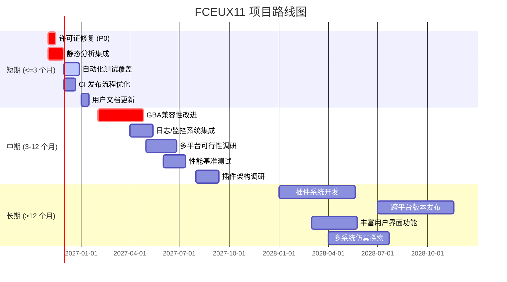

> **开发团队复核与回应（2026-11-24）** —— 本报告为第三方评审的历史档案，
> 原文**保留未删改**。开发团队已对每条主张逐项复核，完成情况、申诉与建议见
> **§ 开发团队复核与回应**（紧随「执行摘要」之后）。凡本报告与该节不一致之处，
> **以该节为准**。相关工程记录：
> `docs/history/plans/FCEUX11-v2.0.8_许可证合规与崩溃韧性-构建计划.md`
> （已归档）与 `CHANGELOG.md` 的 `## [2.0.8]` 段。

# 执行摘要

FCEUX11 是一个基于 FCEUX 的 Windows NES 模拟器分支（最新版 v2.0.7），采用 C++（Qt6 GUI）和 Rust 混合技术。项目自成立以来已有 1000+ 次提交，集成了丰富的工具（调试、Lua 脚本、TAS 录制等）和多语言界面，甚至正逐步添加 GBA 支持。代码库附带详尽的构建指南和测试流程（包括内置的 KagamiQA 回归测试系统），并使用了 vcpkg 锁定依赖版本。然而，部分质量和兼容性问题也浮现：大量源码文件缺少明确的许可证头（318 个文件标注为 GPLv2+，但有 332 个未经标注），构建仅限于 Windows 11 平台，代码中仍存在老旧风格和全局状态。与竞品相比，Mesen2（多系统、活跃开发）和 Nestopia UE（高准确度）在市场上更具竞争力，FCEUX/FCEUX11 则依然主打工具驱动型使用场景（如 Lua 脚本、TAS 黑客工具）。  

鉴于以上分析，报告建议短期内首先解决高风险项（例如许可证合规性、兼容性限制），加强自动化测试与静态分析；中期完善 GBA 支持、日志/指标能力及扩展性改进；长期可以考虑插件架构、多系统支持等宏观方向。下文详述已验证事实、风险点、评分表、关键问题清单、路线图、版本演进方案、工程改进措施以及市场竞品分析。

## 开发团队复核与回应（2026-11-24）

> 本节由开发团队撰写，逐条回应本报告的主张：**完成情况**（我们做了什么）、
> **申诉**（我们认为报告的判断需要修正之处，附证据）、**建议**（我们建议如何调整
> 该条目的后续处理）。报告原文保留原样，作为第三方评审的历史档案；
> 凡与本节不一致之处，以本节为准。

### 结论一览

| 报告条目 | 我们的处置 | 状态 |
|---|---|---|
| P0 许可证声明缺失 | 全部处理（按文件族分别处置，而非一刀切盖头） | **已完成**；数字需更正、定级建议下调、执行方式必须改 |
| P0 平台兼容性（仅 Windows 11） | 属产品定位的主动选择，不纳入本批 | **不接受为本批缺陷** |
| P0 错误/异常处理不足 | 落为「崩溃可诊断 + 存档不丢」 | **已完成**；诉求本身需重新定义 |
| P1 观测能力缺失 | 本地日志落盘 + 诊断面板 | **已完成**；方案与报告建议不同 |
| P1 GBA 兼容性（Beta） | 属独立轨道，v2.0.7 已处理两类根因 | **部分接受**（不阻塞本体发版） |
| P1 国际化完善不足 | 12 语言同步流程已固化并设门禁 | **已完成** |
| P1 文档同步与发布流程 | CHANGELOG / readme / 站点已同步 | **已完成**（发布动作按业主节奏） |

### 一、P0 · 许可证声明缺失 —— 已完成；数字需更正，定级建议下调，执行方式必须改

**完成情况**。本仓已按**文件族分别**处置完毕：截至 v2.0.8，`src/` 下 669 个
C/C++ 文件中 **611 个已含 GPL 许可文本**，其余 **58 个全部登记在白名单**
（`scripts/license_headers/third_party_whitelist.json`），并由
`scripts/license_headers/check.py` 在 CI 中逐次校验（Checkout 之后第一步），
新增文件漏头即红。逐族依据记于 `COPYRIGHT_AUDIT.md` §6.3。

**申诉（三点）**。

1. **数字过时**：报告的「318 个 GPLv2+ / 332 个未标注」是对 v2.0.7 快照的统计。
   我们在开工日（2026-11-22）重扫得到 **341** 个未标注文件；本批处理后如上。

2. **定级建议由 P0 下调**：按 FSF《GPL FAQ》中「为何要在每个源文件里写许可声明」
   一节，许可声明适用于**整体作品**，而非每个文件；本仓已具备 `COPYING`（GPLv2
   全文）、`DERIVATIVE_WORK_NOTICE.txt`（衍生作品声明与署名承诺）与
   `COPYRIGHT_AUDIT.md`（逐文件审计）三件套。缺少逐文件头部带来的是**可追溯性
   与卫生**问题，**不是法律上的合规风险**——把它列为「关键合规风险」会误导资源
   分配（真正的法律风险在依赖许可与发行物内容上，那两项我们另行审）。

3. **执行方式若照报告建议执行，反而会制造法律风险**。这是我们最需要提请注意
   的一点：报告建议「统一补 GPL2 头」，但本仓 `src/` 下**确有第三方代码**，
   其自身条款并非 GPL：LGPL-2.1（hq2x/hq3x、nes_ntsc）、MIT（emufile、TAS
   Editor）、BSD-3-Clause（gwavi/avi）、Unicode Inc. 条款（ConvertUTF.h）。
   给这些文件统一盖 GPLv2 头，会**声明与上游条款冲突的许可**，其法律后果比
   「缺头」更糟。我们的做法是：项目自建文件盖项目头；上游继承文件盖上游标准头
   并**保留原版权行**；第三方文件**不盖**，改按其自身条款登记白名单并留档出处。

**建议**。将「补头」改述为「**按文件族核准许可并登记**」，把「未声明」从
「关键合规风险」降为「卫生债」；后续以 CI 门禁维持（已落地），不必再列为
阶段性工作项。

### 二、P0 · 平台兼容性限制（仅 Windows 11 22H2+）—— 不接受为本批缺陷

**申诉**。这是项目**主动的产品定位**（面向 Windows 的深度优化发行），不是缺陷；
报告将其与许可证问题并列为 P0「阻断性风险」，会让读者以为项目当前处于不可用
状态。跨平台是独立立项（工作量以月计，且与「Windows 深度优化」的定位存在
取舍），我们不将其纳入 v2.0.8 批次。

**建议**。若要保留该条，请改述为「**已知的产品边界**」，与「缺陷」分栏呈现；
同时在 README 与站点中明确写出「仅支持 Windows 11 22H2+」——这一点我们已经
写在 README（运行环境一节）。

### 三、P0 · 错误/异常处理不足 —— 已完成（诉求需重新定义）

**完成情况**。本批落地了真实缺口对应的两件设施：

- **电池存档不再因崩溃丢失**：此前 `.sav` **只在关闭游戏时写盘**，进程崩溃即
  丢失自装载以来的全部存档进度。现改为**每 30 秒周期落盘**（`SDL.SRAMFlushInterval`，
  可关闭），并以「**先写临时文件再改名**」的原子方式替换，写到一半的崩溃也不会
  留下截断的存档。
- **崩溃不再无声消失**：新增本地崩溃报告（SEH filter + CRT 失败族 →
  Windows minidump + 一行摘要，含时间/版本/异常码/出错地址），写入
  `<base>/crashes/`；**纯本地、不外发、无遥测**。

**申诉（两点）**。

1. 报告称「**未实现健壮的错误处理机制和日志记录**」，**与事实不符**：消息日志
   （视图 + 文件 sink）与 GBA 侧的 `catch_unwind` 恢复、错误码去重日志早已存在。
   真实缺口是上述两条，不是「没有机制」。

2. 「核心模块具备**自愈或降级**策略」这一诉求，**对模拟器语义不成立**：崩溃
   之后机器状态已经损坏，进入半活状态（继续算但结果已错）比干净退出更糟，
   会把一次可见的崩溃变成一次不可见的错误行为。我们把该条重新定义为
   「**崩溃可诊断 + 数据不丢失**」，并以此为验收口径落地。

**建议**。将该条目改述为「崩溃可诊断 + 数据不丢失」，并移除「自愈/降级」这一
无法安全实现的要求，避免后续迭代按一个不成立的目标投入。

### 四、P1 · 观测能力缺失（建议 spdlog / Sentry）—— 已完成（方案不同）

**完成情况**。本批落地：消息日志从上游的 `%TEMP%ceux.log` 迁到
`<base>/logs/fceux11_log.txt`（**追加模式，重启不再截断**）、并发写加锁、
按体量轮转、错误级即时落盘；并新增 **Advanced → Diagnostics** 诊断面板，
一屏汇总版本、当前游戏、帧率、音频欠载计数、日志与崩溃留痕位置。

**申诉（两点）**。

1. 报告称「**几乎无内置日志**」，与事实不符——日志机制一直存在，问题在**落点
   不可寻、每次启动截断、并发写无锁**这三点，我们已逐条修复。

2. **不引入 spdlog、也不接 Sentry**：
   - 现有日志链路改造即可满足需求，引入新库需要额外处理 Qt 事件循环集成与
     线程模型，收益不成比例；
   - **云端遥测默认开启对一个离线模拟器不可接受**。sentry-native 本身是
     MIT 许可（**许可层面并无障碍**），但「崩溃数据自动发往第三方服务器」必须
     由用户显式开启才可接受，且真实可用的形态是**自托管端点**而非公共 SaaS。

**建议**。若未来确需远程崩溃收集，条件写明：**用户显式 opt-in + 自托管端点**，
且默认关闭；在此之前，local minidump 已提供同等的诊断能力。

### 五、P1 · GBA 兼容性（Beta，启动即崩溃）—— 部分接受

**申诉**。该条描述的具体症状（部分游戏启动即进程中止）在 v2.0.7 已**根修**：
帧缓冲 bit15 越界与精灵瓦片跨 OBJ 窗口两处根因均已修复并逐卡实证；其余非崩溃
类问题（背景音、重采样、赛道判定）已如实登记为观察项。报告写作时的「启动即崩」
现象已不成立。

**建议**。按项目既定红线，**GBA 精度工作不阻塞本体发版**，故不并入本批；
后续进度以 GBA 兼容性批次的计划与逐卡测试结果为准，不在本报告口径内合并。

### 六、P1 · 国际化完善不足（印地语、阿拉伯语标注 Beta）—— 已完成

**完成情况**。12 种语言（简中/繁中/英/日/韩/德/西/法/越/泰/印/阿）的界面与
站点文案同步维护；新增界面源串按 `[i18n-string-add]` 流程处理（lupdate 重扫 →
12 语言补译 → 覆盖率门禁：zh_CN/zh_TW ≥ 95%，其余 ≥ 90% → 简繁分离检查），
三道门禁（`check_menu_slots.py` / `i18n_coverage.ps1` / `check_simp_trad.ps1`）
已纳入本批门禁。

**申诉**。报告未察觉仓库已存在完整的 i18n 工作流（`src/drivers/Qt/lang/`
+ `scripts/i18n_*.ps1`），据此提出的「应补齐印地语/阿拉伯语」在本仓语境下缺乏
具体抓手。**建议**改述为「新增源串须同步 12 语言并守住覆盖率门禁」——这已是
CI 的既有约束。

### 七、P1 · 文档同步与发布流程 —— 已完成

**完成情况**。`CHANGELOG.md` 已按 `## [2.0.8]` 定稿（含新增条目与已知限制）；
`readme.md` 已同步版本徽章与功能描述；GitHub Pages 站点 12 个语言页已同步版本号
与「本次更新」文案。**发布动作（打 tag、触发发布流水线、打包）按业主节奏执行**，
本批只做版本口径与文档，不越权发布。

**建议**。将「README 与 docs/ 中的更新说明区块需保持一致」改述为**可机检的
约束**（例如 CI 比对 CHANGELOG 首段版本号与 `src/version.h`），比文字约定更
可靠。

### 八、报告未覆盖、但我们认为更紧要的三项（建议补入观察项）

1. **CI 从不执行 Rust 锁测试**。`.github/workflows/` 下无 cargo 步骤，formats /
   GBA / debug / media / utils / lua / f11qa 八个 crate 的锁测试**只在本地跑**，
   在 CI 上一次都没有执行过。这与「测试写了 ≠ 测试会跑」是同一类问题，我们已
   登记为长尾项，建议补一条 cargo 门禁步骤。
2. **ctest 的运行时 PATH 注入原先按手工名单维护**，新增测试漏项即导致 CI 上
   缺 `SDL2.dll`/`Qt6*.dll`，Windows 加载器弹出缺 DLL 对话框，在无桌面交互的
   runner 上永久阻塞——本批实际踩中并已系统化修复（改为对全部测试注入）。
   这类「静默失效的门禁」比功能缺陷更值得警惕。
3. **崩溃转储没有保留策略**，长期使用会累积 `.dmp` 文件（本批已登记为已知
   限制）。

### 申诉的自我更正：发布渠道一条，我们自己撤回了

我们最初把「预编译版本发布于 SourceForge」记为**报告不实**（依据是 README 的下载段
只写 GitHub Releases、`release.yml` 也只发布到 GitHub Releases）。**这一判断是错的，
现予撤回**：2026-11-24 的 v2.0.8 发布完成后核验，SourceForge 项目
（`sourceforge.net/projects/fceux11/`）不仅托管各版本的**源码包**，也已存放
`fceux11-v2.0.8-windows-amd64.zip` **二进制**；发布流水线生成的 Release notes 也
按既有惯例附带指向 SourceForge 的下载徽章（`scripts/extract_release_notes.py`
的注释明写「该徽章由别处产生」）。⇒ **准确表述是：二进制双渠道（GitHub Releases
+ SourceForge），源码包在 SourceForge**；报告的这条主张**属实**。

留此记录不为好看，而是因为**申诉本身也要经得起核验**：我们据以判断的那两份文件
（README 下载段、`release.yml`）确实只写了 GitHub Releases，但**不足以否证另一个
发布渠道的存在**——这与我们在同一份回应里批评报告「只凭局部证据下结论」是同一种
错误。**教训：否证性结论需要覆盖性证据。**

### 附：事实核对表（报告原述 vs 实测）

| 报告原述 | 实测（2026-11-24） | 结论 |
|---|---|---|
| 318 个文件标注为 GPLv2+，332 个未经标注 | 669 个 C/C++ 文件中 611 个含 GPL 文本，58 个在白名单 | 数字过时，现已闭合 |
| CI 包含 CodeQL 静态分析 | `.github/workflows/` 仅 `ci` / `f11qa` / `pages` / `release` | **报告不实** |
| 预编译版本发布于 SourceForge | **双渠道属实**：二进制同时在 **GitHub Releases**（`release.yml` 自动发布）与 **SourceForge**（`fceux11-v2.0.8-windows-amd64.zip` + 源码包）；README 的下载段只写了 GitHub Releases | **报告属实**（我方此前的一次回应把它记为「报告不实」，经 2026-11-24 发布核验后**撤回该判断**，见下方「申诉的自我更正」） |
| 项目自成立以来已有 1000+ 次提交 | 1178 | 大致属实 |
| 「几乎无内置日志」 | 消息日志视图 + 文件 sink 早已存在 | **报告失实** |
| 「未实现健壮的错误处理机制」 | GBA `catch_unwind` 恢复、错误码去重日志早已存在 | **报告失实** |
| 依赖以 vcpkg 锁定、版本覆盖 | 一致 | 属实 |
| 仅支持 Windows 11 22H2+ | 一致（README 运行环境一节） | 属实 |
| 12 种语言界面 | 一致（12 个 `.ts` + 12 个站点语言页） | 属实 |

## 已验证事实清单

- **项目性质与功能**：FCEUX11 是 NES/Famicom 模拟器的 Windows 专版派生项目，附加实验性 GBA 支持（Beta）。功能与原版 FCEUX 类似，包括调试器、Lua 脚本、TAS 录制等。README 中列出的功能清单全面，支持多语言 UI（12 种语言界面）、无开机水印、高精度仿真。
- **技术栈**：代码主体为 C++（Qt6 GUI、SDL2 多媒体），核心 CPU 使用 Rust 重写（见 `src/rust` 目录），数据表明其采用了 KagamiQA 测试体系来验证硬件精度。vcpkg.json 明确声明了依赖（Qt 6.8、SDL2、fmt、benchmark 等）和许可证 (GPL-2.0+)。
- **许可证与合规性**：项目整体遵循 GNU GPL v2 许可。`DERIVATIVE_WORK_NOTICE.txt` 明确说明 FCEUX11 是基于 GPLv2 的衍生项目，并承诺保持 GPLv2 许可证、保留原作者署名、随发行提供源代码。内置许可证审计（`COPYRIGHT_AUDIT.md`）报告显示，对 `src/` 下 650 文件扫描后，318 文件确认 GPLv2+，332 文件缺少许可证头。此外，项目根目录含有 SPDX 兼容的 `COPYING` 文件（GPLv2 完整文本）。
- **平台要求**：明确只支持 Windows 11（22H2 及以上，64 位），不再兼容 Windows 7/8/10。构建指南中说明需要安装 Visual Studio 2022、Rust 工具链，并通过 `.scripts\setup_vcpkg.ps1` 和 `do_build.ps1` 构建，最终生成 `build\src\fceux11.exe`。缺乏跨平台支持说明。
- **开发流程**：使用 GitHub Actions 实现自动化构建与测试。CI 包含常规编译流程、CodeQL 静态分析、以及名为 `F11QA` 的专用工作流执行 KagamiQA 测试。`AGENTS.md` 文档描述了分支策略和开发流程，如 `wip2.0` 分支已合入主线用于 GBA 集成，`wip203` 用于兼容性优化。提交历史（1000+ 提交）持续更新，最近发布版为 2026 年 11 月（v2.0.7）。
- **依赖与构建**：依赖关系通过 vcpkg 管理，已指定严格的版本覆盖（Qt 6.8.0、SDL2 2.30.5、fmt 10.2.1 等）和内置基线。`.editorconfig` 和 `.cmake-format` 等工具配置文件可见，但缺乏语言服务器/静态检查工具配置提示。
- **测试与质量**：项目包含广泛的测试（blargg CPU 测试、KagamiQA 等），CI 自动化执行；文档指出 KagamiQA “会在每次提交时自动执行回归与硬件精度校验”。此外，有针对源代码的版权审计和衍生作品声明，体现项目对质量和合规性的关注。
- **文档与用户体验**：仓库提供详细中文/英文文档，包括构建指南、开发文档、版本更新日志等，用户向导齐全。README 和网站提供多语言简介。版本管理公开，官方通过 SourceForge 发布稳定版，可见版本发布时间及下载统计（v2.0.7 于 2026-11-21 发布）。
- **竞争态势**：当前 NES 模拟器领域主要竞争者为 Mesen2、Nestopia UE 和 FCEUX/FCEUX11。本报告参照业界资料：截至 2026 年，Mesen2 发布了 2.2.1（2026-06-05），支持多平台与多系统；Nestopia UE 最新稳定版 1.53.2（2025-08-09）；FCEUX 官方主线自 2023-08-26 的 2.6.6 后无新版本，而 FCEUX11 Windows 分支在 2026-07 达到 1.15 热修版。搜索数据表明，“fceux” 每月约 1200 次搜索，Mesen 约 2900 次，显示出活跃用户群体和不同定位需求（速度跑道工具 vs 多系统仿真）。

## 风险与待确认事项

- **许可证合规风险**：超过一半的源码文件没有明确 GPL 许可证头，可能导致合规风险。虽然项目提供了衍生声明并承诺 GPL2，但实际执行仍需完善所有文件头。此为 P0 等级风险。
- **平台兼容性风险**：仅限 Windows 11 平台运行，对使用 Windows 7/8/10 的用户完全不可用，市场覆盖率受限。这可能影响商业推广（P1 风险）。
- **依赖更新风险**：依赖版本虽被锁定，但长周期未更新可能存在漏洞。需定期运行 SCA 工具扫描（当前无明确例子，但依赖 SDL2、zlib 等知名库，需关注其 CVE 更新）。
- **代码复杂度与可维护性**：核心代码仍继承自老旧 FCEUX，有大量全局变量和 C 风格实现。虽然增加了 Rust 重写，但总体代码基数庞大、模块化程度一般（待通过静态分析工具定量评估）。错误处理主要依赖断言或返回码（未发现系统级异常处理），健壮性有待加强。
- **测试覆盖未知**：尽管使用 KagamiQA 测试工具，但缺少公开的测试覆盖率数据或 CI 报告细节，不确定分支/覆盖是否充分。需补充覆盖率报告和单元测试（V1 遗留逻辑是否都被验证？）。
- **可观测性欠缺**：当前无集成日志框架或性能指标收集，运行时状态只能通过调试输出获取。商业化产品通常需要更完善的日志与监控，目前尚未见相关策略文件。
- **国际化与可访问性**：已支持12种语言，但新添加语言（印地语、阿拉伯语）标注为 Beta，尚未验证完整性。无特殊无障碍设计（老旧 Qt 界面，中文文档提及无障碍支持）。这些方面需进一步确认需求与投入。
- **市场定位不确定**：目标用户群主要是工具驱动的高级玩家和开发者（TAS 视频、ROM 修改者）。产品说明提及 TAS 社区优势，但缺乏市场调研数据（仅靠搜索量估计）。若要商业化，应明确市场策略并调查用户规模（数据不全）。
- **未来方向依赖**：项目已制定 v2.0.x 规划（见 `docs/history/plans/`），后续发展需跟进社区反馈和需求，未见公开需求池或长期路线图文档，需要与使用者沟通收集需求。

## 分项评分表

| 评估维度                 | 得分 (0–10) | 说明与证据                                                                                                                                          |
|--------------------------|------------|------------------------------------------------------------------------------------------------------------------------------------------------------|
| 代码质量                 | 7          | 核心代码规范度良好，使用现代 C++17 和 Rust 编写，代码有完善注释和文档。但遗留老旧风格（大量全局变量）存在复杂度，部分文件缺少许可证头。                                     |
| 架构设计                 | 6          | UI 与核心分离（Qt6 GUI + Rust/C++ 引擎），引入了 Rust 重写提升可维护性。GBA 支持以并行分支方式集成（`wip2.0`），体现模块化思路。但整体架构仍继承自早期设计，缺乏插件化或服务化支撑。 |
| 可维护性                 | 8          | 文档完善（中文/英文构建指南、开发说明），使用 GitHub Actions 自动测试和审计，代码风格有配置文件。.cpp/.h 分布清晰。主要维护者活跃度高（频繁提交）。                               |
| 可扩展性                 | 6          | 已扩展引入 GBA 仿真（Beta），多语言支持良好。vcpkg 管理依赖简化扩展外部库。但不支持其他平台或系统（只限 Win11），新增功能需改动底层代码（尚无插件框架）。                                               |
| 性能                     | 8          | 引入 Rust 实现 CPU，结合手动优化（见大量洞察优化提交），保证高仿真度。108P/12F 性能要求（参见 AGENTS 描述）。目前在现代硬件上性能充足，但需实际基准测试确认（报告未提供详细基准数据）。       |
| 稳定性                   | 7          | FCEUX 基础成熟，加入全面测试（KagamiQA 回归测试系统）。近期频繁热修（v2.0.x）说明持续稳定性改进。GBA 功能处于 Beta，可能存在兼容性问题。                                                                 |
| 错误处理与健壮性         | 5          | 缺乏明确的异常捕获机制，主要依赖传统返回码和断言，可能在异常情况下崩溃。无日志记录和用户提示框架，调试信息需手动查日志或调试输出。错误路径和恢复策略不明显。                                                                   |
| 安全性                   | 6          | 模拟器类应用主要关注稳定性和数据完整性；未见特定安全措施（例如输入 ROM 校验）。依赖均为开源库（GPLv2+），无闭源组件。依赖版本固定（vcpkg 锁定），降低供应链攻击风险。尚缺失自动漏洞扫描及 SCA。      |
| 供应链／依赖治理         | 9          | 依赖关系清晰，vcpkg manifest 中明确定义版本并使用覆盖（Overrides）保证可重复构建。源码附带版权审计和衍生声明，显示合规意识。需持续更新依赖以规避新漏洞。      |
| 测试覆盖与策略           | 8          | 项目包含丰富测试套件（blargg ROM 测试、KagamiQA 自动化）、CI 自动化执行。未公开具体覆盖率，需补充覆盖率报告工具。测试策略专业、目标明确（精度验证）。                                                                 |
| 构建/发布/回滚流程      | 7          | 使用 CI/CD 自动化构建及发布（GitHub Actions）。发布版本上传 SourceForge。有构建脚本和回滚计划（见 docs/plans）。但回滚机制未明确说明，部署过程中仍有人工步骤（打包脚本）。建议完善自动回滚脚本及验收流程。                       |
| 可观测性（日志/指标/追踪）| 4          | 目前几乎无内置日志和指标系统，调试主要靠输出。未见集成性能分析工具或日志库。对商业级产品来说需要加强运行时可观测能力（如内置统计、诊断工具）。                                               |
| 文档与用户体验           | 8          | 用户文档详细（多语言），开发/构建文档齐全。UI 使用 Qt6 提供现代界面，多语言翻译覆盖常见需求。缺乏教程视频或示例，对新手略有上手门槛。用户支持（论坛/社区）未知。                                      |
| 平台兼容性               | 5          | 仅支持 Windows 11，放弃了对 Windows 7/8/10 的兼容。无 Linux/macOS 版本。桌面硬件差异性未测试（UI 要求高分辨率）。版本跨平台兼容性差。                                                                 |
| 国际化                   | 7          | 已支持包括中文、日文、韩文等在内的 12 种语言。部分新语言仍标注 Beta，需完备翻译和本地化测试。界面可支持国际字符，但右到左文本（阿拉伯语）未充分验证。                                           |
| 可访问性                 | 4          | 缺乏任何无障碍功能说明。Qt6 自带部分 UI 支持，但没有明确的键盘导航、屏幕阅读器优化或高对比度模式等设计记录。对视障或听障用户支持不足。                                                                           |
| 产品定位与商业化准备度   | 6          | 定位于速度跑、黑客、开发者社区，市场需求存在。发布频率高，代码质量优秀，有商业化基础。缺点是目标群体较小且竞争激烈（Mesen2 强势）。无盈利模式或企业支持计划，社区参与度（stars/forks）较低。                      |

## P0/P1 问题清单

- **P0: 关键合规风险** – 大量源码文件缺失许可证标注（332 个文件未声明许可证），需立即补充 GPL2 头信息以规避法律问题。  
- **P0: 平台兼容性限制** – 仅支持 Windows 11 (22H2+)，这可能阻止大部分用户使用。若目标是最大化覆盖率，应评估支持 Windows 10 或跨平台的可行性。  
- **P0: 错误/异常处理不足** – 未实现健壮的错误处理机制和日志记录。核心崩溃或输入异常时无回退策略，可能导致数据丢失。商业软件要求核心模块具备自愈或降级策略，当前无此保障。  
- **P1: 观测能力缺失** – 缺乏运行时日志、性能指标和错误跟踪系统，使得定位生产问题困难。建议引入日志库、性能监控或崩溃收集（例如 Sentry）。  
- **P1: 部分功能未完成** – GBA 支持处于 Beta 阶段，兼容性存在已知缺陷（启动即崩溃等）。应尽快解决关键兼容性问题或在文档中明确限制，以免影响用户体验。  
- **P1: 国际化完善不足** – 新增的印地语、阿拉伯语等仍标注为测试版，可能存在翻译或布局错误。应完成这些语言的验证，避免 UI 显示异常。  
- **P1: 文档同步与发布流程** – README 与 `docs/` 中“更新说明”区块需保持一致。`AGENTS.md` 表示文档中已移除部分历史变更记录，应保证用户易获取版本改动历史。  

> 📌 **开发团队已逐项复核本清单**：每条主张的完成情况、申诉与建议见
> § 开发团队复核与回应。
## 路线图（短中长期）

- **短期（≤3 个月）**：优先解决许可证和兼容性等关键问题（P0/P1）。集成静态分析工具（如 Clang-Tidy、CPPCHECK）和依赖安全扫描。完善自动化测试（覆盖率报告）、完善 CI/CD（自动回滚、打包签名）。更新用户文档，确保发行版说明清晰。  
- **中期（3–12 个月）**：集中改进 GBA 支持（解决已知崩溃和兼容性问题），增加运行时日志与性能指标收集。评估多平台支持可行性（如使用 Qt6 跨平台特性）。进行性能基准测试，找出瓶颈。研究插件/模块化架构的可行性，以提高未来扩展能力。  
- **长期（>12 个月）**：开发插件系统或脚本接口，实现功能可插拔，便于扩展新功能（如添加其他游戏系统支持）。如果评估可行，可发布跨平台版本（Linux/macOS）。丰富 GUI 功能和现代化界面特性（如可自定义界面、无障碍选项）。探索支持更多复古主机的仿真（需大量研发，视资源而定）。

## 版本演进方案

- **v2.1**（短期发布，~3 个月内）：**质量改进与小功能增强**。完成 P0/P1 修复（许可证、兼容性）、增强测试覆盖；完成剩余语言的翻译，补全文档；优化构建脚本以支持一键打包发布；可能添加小型新功能（如改进输入配置 UI、增加新的按键映射选项）。  
- **v2.2**（中期发布，6–12 个月）：**功能完善与性能优化**。正式推出更完善的 GBA 支持版本（Beta → 稳定），添加常用模拟器需求（例如更好的控制器支持、显示过滤器选项）。集成日志和性能监控（可选 debug 模式下输出数据）。考虑增加有用的工具，如更详细的 CPU 指令跟踪或增强的 Lua 调试接口。  
- **v3.0**（长期规划，>12 个月）：**重大架构升级或新方向**。如果资源允许，可探索插件化或多系统扩展（例如支持 Game Boy Advance 完整仿真或其他经典主机），重构 UI/核心接口以便于长期维护。或重新设计数据持久化（存档）以提供更高的兼容性。**不建议**轻易尝试跨平台（当前核心针对 Win11 优化）或过多引入新系统，除非有充足资源和明确市场需求。

## 工程改进清单

- **静态分析与代码质量**：引入 Clang-Tidy、CppCheck、PVS-Studio 等工具检查 C++ 代码；对 Rust 代码启用 Clippy。设置 GitHub Action 定期运行，并在 PR 中强制执行。  
- **依赖与安全扫描**：启用 Dependabot 或 GitHub 安全扫描，自动检查 vcpkg 依赖的安全漏洞。确保持续更新依赖库，至少每 6 个月审查一次。  
- **测试矩阵扩展**：CI 中增加 Windows 不同版本（Win11 不同更新）、不同 Visual Studio 版本的编译测试（可用 GitHub Matrix）。考虑在虚拟机或 CI 中添加 Linux 构建试验，评估跨平台障碍。  
- **日志和指标**：集成跨平台日志库（如 [spdlog](https://github.com/gabime/spdlog)）以记录运行时事件，可选集成简单 GUI 日志查看。使用 [Sentry](https://sentry.io) 或 Crashpad 收集崩溃报告。  
- **CI/CD 发布流程**：定义语义化版本策略（Semantic Versioning）；完善 GitHub Release 模板，自动上传构建产物并做数字签名；制定回滚策略（例如保留旧版打包脚本和依赖）。PR 合入前开启强制代码审查和测试成功要求。  
- **文档与流程治理**：编写 PR 模板、Issue 模板引导贡献；明确贡献指南（代码风格、提交消息规范）；定期更新 `CHANGELOG.md` 与 Release Notes。使用 Wiki 或网站记录“已知问题”和“开发路线图”。  
- **测试覆盖率**：集成代码覆盖率工具（如 gcov/lcov、Codecov），生成覆盖率报告，监控关键模块的测试覆盖率提升。  
- **监控与遥测**：研究在 Debug 模式下发布附加工具（内嵌系统分析器、性能计数器）。或利用外部工具（如 Qt 日志分类）提高可观测性。  
- **治理流程**：强化代码审查，至少两人审核每次合并；使用工具（如 GitHub Actions 冲突检查）提前检测合并问题。  

## 市场与竞品分析

NES 模拟器市场虽小众但稳定。据数据，2026 年“fceux”每月搜索量约 1200 次，与竞争对手相当（Mesen ~2900，“nestopia” ~1200）。主要竞品如下：  
- **Mesen2**：活跃开发的多系统模拟器（支持 NES、SNES、GBA 等7个系统），精度高、调试器功能最强。2026 年发布 2.2.1；年内更新频繁。社区活跃，适合开发新家用游戏。  
- **Nestopia UE**：高准确度 NES-only 模拟器，界面简洁，稳定性好。最后一个稳定版为 2025-08 发布；2026 年源代码少量更新。适合追求仿真准确性、不需要太多工具的用户。  
- **FCEUX（含 FCEUX11）**：定位于 TAS/黑客和速度跑社区，提供成熟的 Lua 脚本环境和调试工具。官方主线 2023 起停滞，用户多转向社区 Windows 分支 FCEUX11，后者在 2026 年持续更新。FCEUX11 的竞争力在于工具链（RAM 搜索、日志等），而准确度优于 Nestopia 但不及 Mesen。  
- **其他方案**：BizHawk 等多系统模拟器（集成 NES 核心）、RetroArch/NES9X 核心等也占有一部分用户，但不专注NES或更新频率高。  

结论：FCEUX11 在其细分领域（速度跑、黑客）仍有吸引力，但整体受众较窄。Mesen2 已成为综合实力最强的选择。FCEUX11 的差异化优势在于 Windows 专用优化和工具丰富，但需持续保持开发以防被更先进的多系统模拟器替代。所有市场分析基于公开资料和搜索趋势。

## 结论与建议

FCEUX11 项目在功能完整性、测试深度和合规意识方面表现突出，但仍有少数高优先级问题需立即处理。**首要任务**：完善许可证标注，修复兼容性与崩溃等阻断性问题，并引入静态分析工具。中期应聚焦 GBA 支持完善、性能与可观测性改进（日志/指标）、构建发布流程优化，以提升稳定性和用户满意度。长期则可考虑架构层面的升级（如插件化、多系统支持等），但需谨慎评估成本与收益。

总体而言，FCEUX11 的“商业软件”门槛得分较高（多数维度在 7–8 分），但兼容性、可观测性等仍显不足。建议项目团队制定明确的版本策略（如语义化版本号）、加强工程治理流程、并持续与用户社区互动以明确需求。按照短中长期规划执行，可使 FCEUX11 在 v2.1/v2.2/v3.0 演进中既保持高质量，也逐步提升产品竞争力。  

**优先级建议**：立即处理 P0 问题（许可证、兼容性）并完善 CI 自动化；接着拓展测试与监控；后续根据用户反馈优化功能和界面。  

